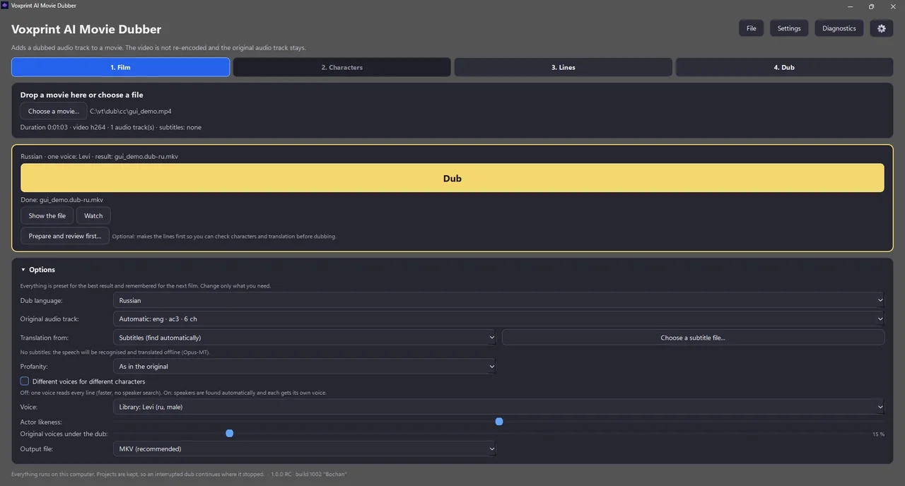
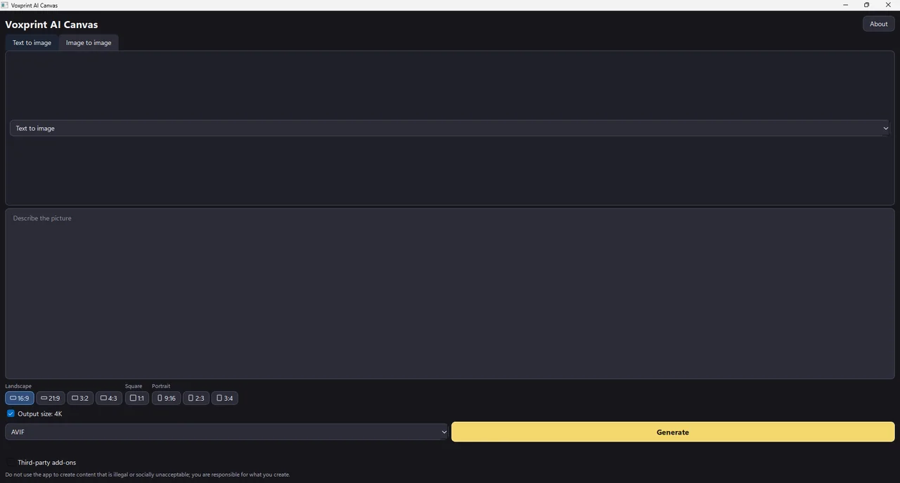
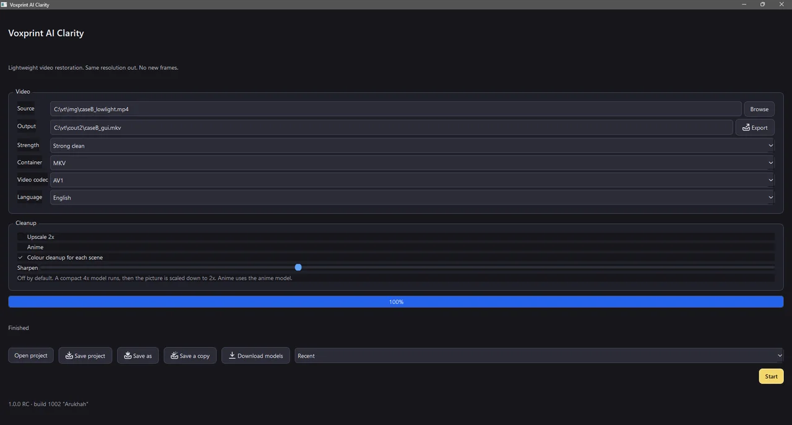

# Aleksandr Mitroshenkov

I build **Voxprint AI Media Suite**, a family of free, open-source desktop apps that run modern AI on your own PC: voice, books, images and video. No cloud, no subscriptions, and nothing is uploaded.

The apps share one runtime and one look, so they install side by side and hand work to each other: Plotweaver writes a novel that Audiobook Builder narrates, and Canvas and Lucent pass pictures to Enlarge for upscaling. They target Windows 11 with an NVIDIA RTX 40-series GPU or newer, with Linux builds for most apps. Most are release candidates right now.

## 🎙️ Voice and stories

<table>
  <tr>
    <td width="50%" valign="top">
      
      <h3><a href="https://github.com/Mitroshenkov87/voxprint-audiobook-builder">Audiobook Builder</a></h3>
      Turns books (TXT, FB2, EPUB) into multi-voice audiobooks, offline. Train a voice from a short recording of your own, or use open CC0 voices. Exports Opus, MP3 per chapter or M4B.
    </td>
    <td width="50%" valign="top">
      
      <h3><a href="https://github.com/Mitroshenkov87/voxprint-movie-dubber">Movie Dubber</a></h3>
      Adds a dubbed audio track in your language to films and series. Speech is recognised, translated and re-voiced with voices cloned from the film or open CC0 voices. The video and the original track stay untouched.
    </td>
  </tr>
  <tr>
    <td width="50%" valign="top">
      
      <h3><a href="https://github.com/Mitroshenkov87/voxprint-plotweaver">Plotweaver</a></h3>
      Writes a whole novel from a synopsis of about five pages. It plans, drafts and exports the book with local language models only, and the result can go straight to Audiobook Builder.
    </td>
    <td width="50%" valign="top"></td>
  </tr>
</table>

## 🖼️ Images and video

<table>
  <tr>
    <td width="50%" valign="top">
      
      <h3><a href="https://github.com/Mitroshenkov87/voxprint-canvas">Canvas</a></h3>
      Local text-to-image and image editing on your own GPU: restyle, inpaint, outpaint, pose, depth and instruction edits. Output in AVIF, JPEG XL or WebP, up to 4K with Enlarge.
    </td>
    <td width="50%" valign="top">
      
      <h3><a href="https://github.com/Mitroshenkov87/voxprint-enlarge">Enlarge</a></h3>
      Offline AI image upscaling and restoration with modern, licence-safe models. Batch queue, before/after slider, headless command line, and AVIF, JPEG XL and WebP output.
    </td>
  </tr>
  <tr>
    <td width="50%" valign="top">
      
      <h3><a href="https://github.com/Mitroshenkov87/voxprint-clarity">Clarity</a></h3>
      Lightweight video restoration: deblocking, denoising, light sharpening and per-scene colour cleanup, with optional 2× upscaling. No invented frames and no artificial "enhanced" look.
    </td>
    <td width="50%" valign="top">
      
      <h3><a href="https://github.com/Mitroshenkov87/voxprint-lucent">Lucent</a></h3>
      An instant, colour-accurate image viewer with first-class AVIF, JPEG XL and WebP, HDR tone mapping and one-click AI upscaling through Enlarge.
    </td>
  </tr>
</table>

## 🧰 Under the hood

- **[voxprint-common](https://github.com/Mitroshenkov87/voxprint-common)**: the shared library behind every app, covering build info, the shared runtime manifest, GPU lock, downloads, splash screen and theme.
- **[voxprint-model-forge](https://github.com/Mitroshenkov87/voxprint-model-forge)**: tooling that prepares, quantizes, evaluates and documents the local models the apps use.

## How the apps work

- Powerful AI tools available to everyone, on your own hardware, with no gatekeeping or paywalls.
- Everything runs on your own PC, offline, with no account and no subscription.
- Your files never leave your device.
- Free and open source under the Apache-2.0 licence.
- Built for current hardware: Windows 11 or Linux with an NVIDIA RTX 40-series GPU or newer.
